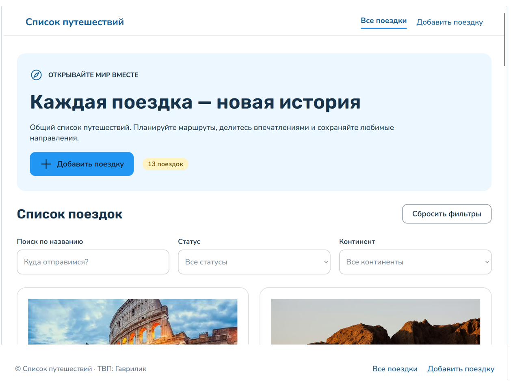
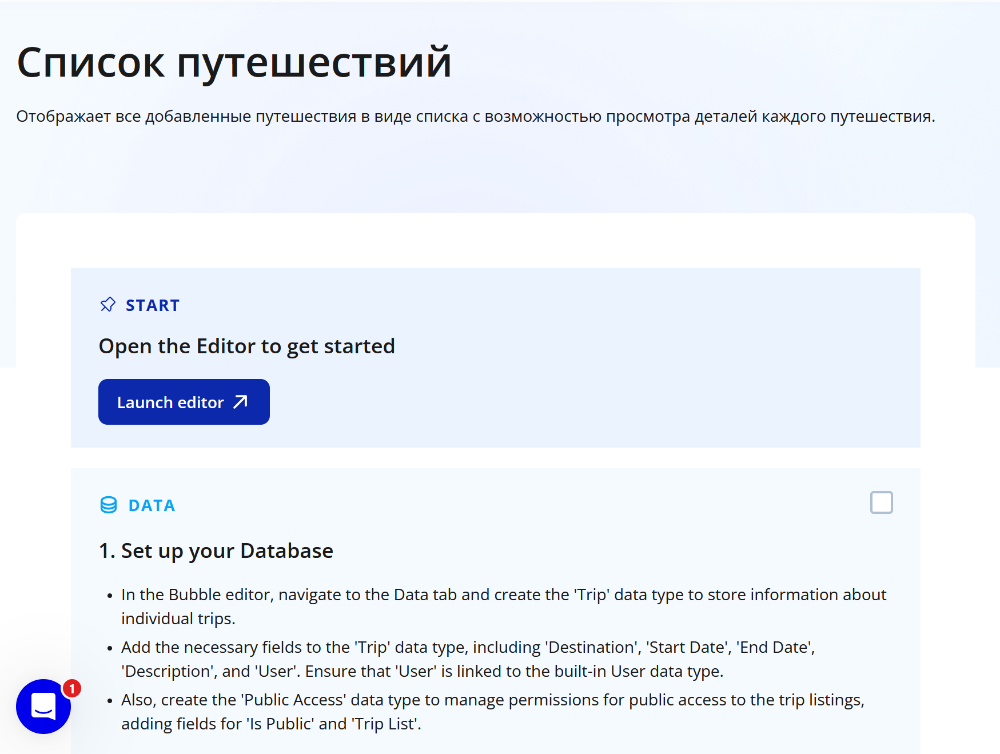
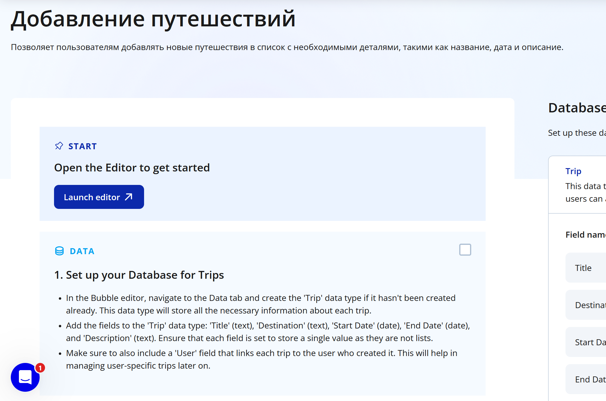
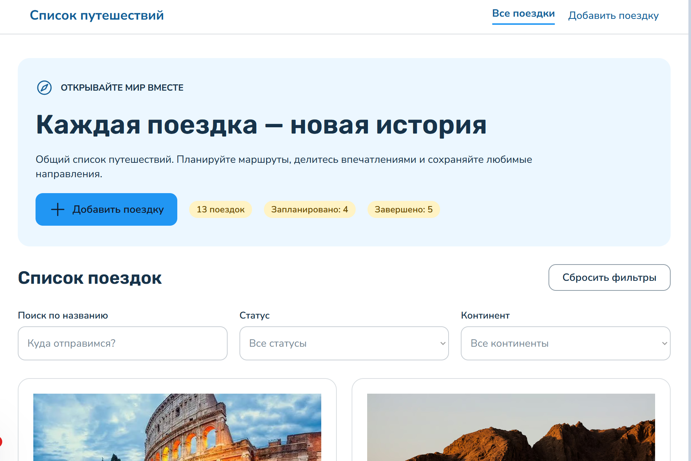
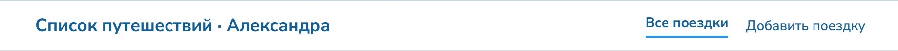
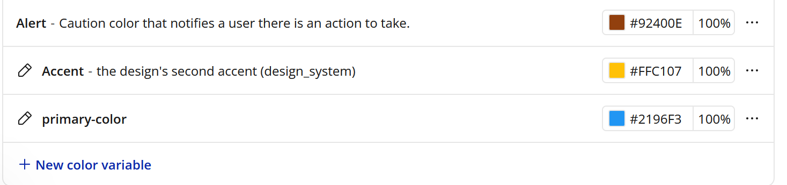
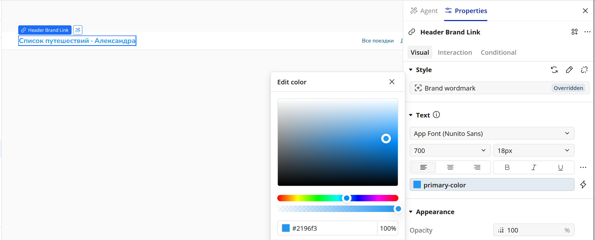
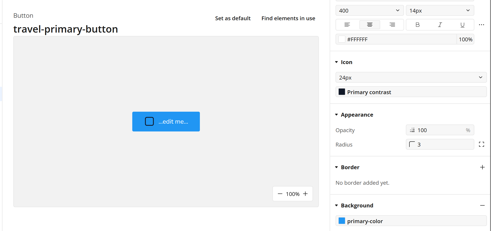
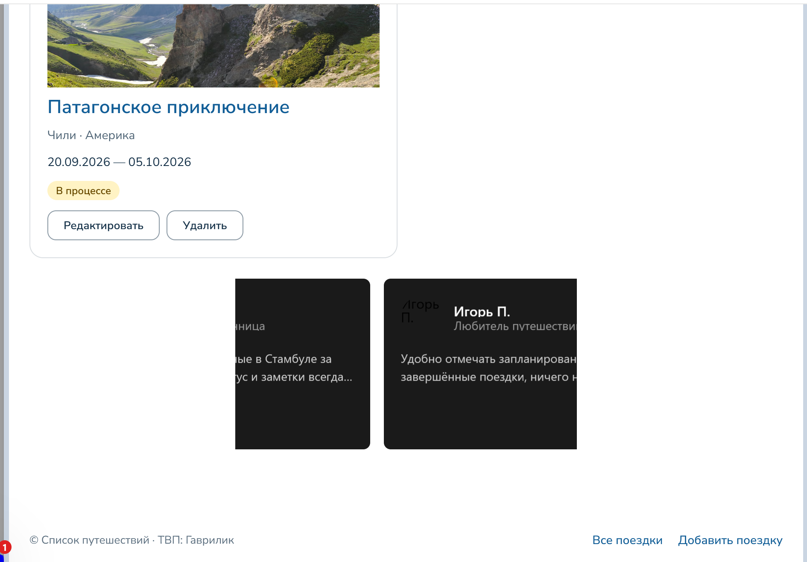

# Лабораторная работа №3. Bubble

## 1. Краткое описание выполненного

_(заполню в конце)_

## 2. Промпт (дословно, часть 1)

```
Создай приложение на тему «Список путешествий»
Пусть этот сайт будет публичный
Страницу обязательно создай по структуре header + body + footer
Обязательно укажи в заготовке следующую строку: «ТВП: Гаврилик»
Добавь несколько интерактивных элементов (реализующих CRUD)
```

## 3. Ссылка на dev-версию приложения

https://bubble.io/page?id=my-app-261006-71085&tab=Preview&name=index&ai_generated=true

## 4. Использованные AI-промпты (дословно)

### 4.1. Промпт для каркаса приложения
_(см. раздел 2)_

### 4.2. Промпт для новой сущности (часть 4.1)
_(...)_

### 4.3. Промпт для UI страницы с CRUD (часть 4.2)
_(...)_

## 5. Освоенные элементы и workflows

_(...)_

## 6. Скриншоты по шагам

### Часть 1. Генерация каркаса

### Часть 2. Build Guides (до / после)

**Что изучено.** В разделе Build Guides Bubble сформировал персональные Build Docs для моего приложения «Список путешествий»: публичный доступ, структура страницы header + body + footer, добавление, редактирование, удаление и список путешествий. Подробно я изучила два гайда: «Список путешествий» и «Добавление путешествий».





**Что показалось полезным.**
- Из гайда «Список путешествий»: как данные выводятся в виде списка и как их можно отфильтровать и посчитать. Я сопоставила шаги гайда с тем, что сгенерировал AI-агент, и увидела, какие элементы отвечают за вывод данных.
- Из гайда «Добавление путешествий»: какие поля нужны форме и как они связаны с данными.

**Что взято в приложение.** В приложении, сгенерированном агентом, в верхнем блоке был только общий счётчик поездок. По идее из гайда о работе со списком данных я добавила счётчики по статусам: «Завершено» и «Запланировано». Каждый счётчик считает записи типа «Поездка» с ограничением по статусу.

**Как это сделано.** В редакторе (вкладка Design) я скопировала плашку с общим счётчиком (Total Text) и изменила выражение в поле Text: в окне Search for Поездка во вкладке Constraints добавила ограничение «Статус = Завершено» и оставила функцию :count. Перед выражением вписала подпись «Завершено: ». Так же сделала счётчик для статуса «Запланировано».

**Что сгенерировал AI, а что сделано вручную.** Общий счётчик, карточки и цветное оформление статуса (три условия во вкладке Conditional у Badge Text) создал AI-агент. Счётчики по статусам я добавила сама.

**До и после:**

| До | После |
|---|---|
|  |  |
### Часть 3. Ручная доработка UI

Всё в этой части сделано вручную, без AI-агента.

#### 3.1. Заголовок с именем

Заголовок находится внутри многоразового элемента Header, поэтому для правки я открыла сам Header (через выпадающий список страниц вверху редактора) и в поле Content → Text дописала своё имя. Фамилия уже есть в футере из промпта («ТВП: Гаврилик»). Получился текст: **«Список путешествий · Александра»**. Так как Header многоразовый, имя отображается на всех страницах, где он используется.



#### 3.2. Global variable для цвета

Я создала цветовую переменную **`primary-color`** со значением **`#2196f3`** (основной синий цвет приложения, как у кнопки «Добавить поездку»). Создание выполнено в палитре цвета, в блоке Variables (кнопка «+»). Затем я применила переменную к элементу страницы, выбрав её из списка Variables, а не из палитры (результат виден на скриншоте 03b).

Смысл переменной: если изменить её значение, цвет обновится сразу у всех элементов, к которым она применена, и не нужно править каждый вручную.





#### 3.3. Новый стиль

Я создала стиль **`travel-primary-button`** (Element style: Button) на основе кнопки «Добавить поездку» (Add Button). В настройках стиля фон (Background) задан переменной `primary-color`, цвет текста белый. Стиль применён к кнопке «Добавить поездку»: его название отображается в её Properties.



#### 3.4. Готовый компонент

Из каталога Install More я установила бесплатный плагин **Testimonial Section Slider** и добавила его на страницу index, так как такого элемента на ней ещё не было. Отзывы задаются в поле JSON Data списком объектов с полями имени, подписи и текста. Заглушку (Sarah Anderson, Lorem ipsum) я заменила своими отзывами о путешествиях. В Preview слайдер прокручивается, отзывы отображаются (см. скриншот).



### Часть 4. Data и Workflows
### Часть 5. Ачивка

## 7. Выводы

_(своими словами)_
