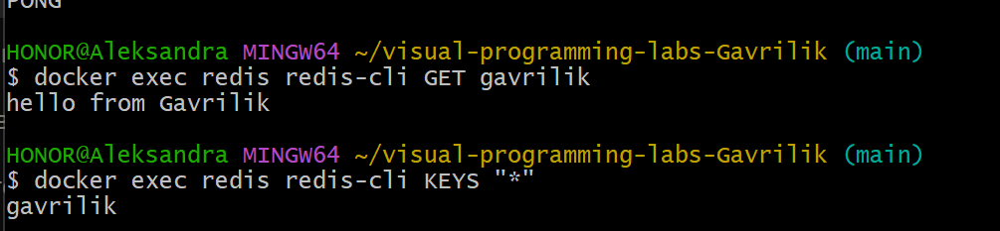
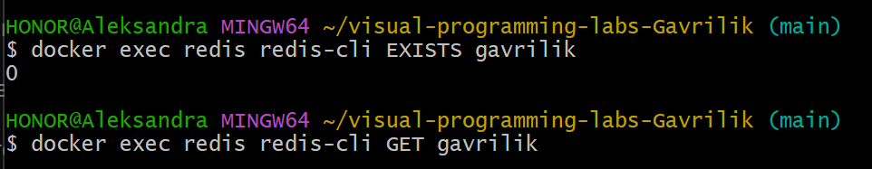

# Redis: создание и удаление ключа

Лабораторная работа №4, Часть 3. Студент: Gavrilik.

## 1. Установка Redis

Redis запущен в Docker:

```bash
docker run -d --name redis -p 6379:6379 redis:7
```

- `--name redis` имя контейнера;
- `-p 6379:6379` порт Redis проброшен на хост;
- `redis:7` образ Redis седьмой версии.

Проверка, что сервер отвечает:

```bash
docker ps
docker exec redis redis-cli ping
```

Ответ `PONG` означает, что Redis работает.


## 2. Подключение Redis к n8n (credentials)

В n8n создана credential `Redis Gavrilik`:

| Поле | Значение |
|---|---|
| Host | `host.docker.internal` |
| Port | `6379` |
| Password | пусто |
| Database Number | `0` |
| SSL | выключено |

n8n работает внутри своего контейнера, поэтому `localhost` для него указывает на сам контейнер, а не на компьютер. Имя `host.docker.internal` в Docker Desktop указывает на хост, где проброшен порт Redis. Проверка соединения прошла успешно (сообщение `Connection tested successfully`).


## 3. Workflow 1: создание и чтение ключа

Файл: `lab4/flows/flow-09-redis.json`.

Цепочка: **Manual Trigger → Redis (Set) → Redis (Get)**.

**Redis (Set)**

| Параметр | Значение |
|---|---|
| Operation | Set |
| Key | `gavrilik` |
| Value | `hello from Gavrilik` |
| Key Type | String |

**Redis (Get)**

| Параметр | Значение |
|---|---|
| Operation | Get |
| Name | `value` |
| Key | `gavrilik` |
| Key Type | String |

Поле Name это имя свойства, в которое n8n кладёт прочитанное значение. После запуска в Output ноды Get появилось `value: "hello from Gavrilik"`.


Независимая проверка из терминала:

```bash
docker exec redis redis-cli GET gavrilik
docker exec redis redis-cli KEYS "*"
```



## 4. Workflow 2: удаление ключа и проверка отсутствия

Файл: `lab4/flows/flow-10-redis.json`.

Цепочка: **Manual Trigger → Redis (Delete) → Redis (Get)**.

**Redis (Delete)**

| Параметр | Значение |
|---|---|
| Operation | Delete |
| Key | `gavrilik` |

**Redis (Get)** (проверка) настроен так же, как в первом workflow. После удаления значение `value` пустое (`null`), потому что ключа больше нет.

> В ноде Redis в n8n нет операции **Exists**, которая упомянута в задании (доступны Delete, Get, Incr, Info, Keys, Pop, Publish, Push, Set). Поэтому отсутствие ключа проверено двумя способами: через Get в n8n и командой `EXISTS` в redis-cli.


Проверка в терминале:

```bash
docker exec redis redis-cli EXISTS gavrilik   # (integer) 0
docker exec redis redis-cli GET gavrilik      # (nil)
```

Ответ `0` означает, что ключа нет, `(nil)` что значения нет.



## 5. Pub/sub (дополнительно, ачивка 10)

Кроме хранения ключей, Redis умеет передавать сообщения через каналы (publish/subscribe). Это использовано в ачивке 10:

- `flow-11-pubsub-publisher.json`: Manual Trigger → Redis (Publish) в канал `lab4-gavrilik`;
- `flow-12-pubsub-subscriber.json`: Redis Trigger на канале `lab4-gavrilik` → Code.

Проверка подписки со стороны Redis:

```bash
docker exec redis redis-cli PUBSUB NUMPAT
```

Команда возвращает число подписок по шаблону (подписчик n8n виден именно так). Сообщение в канале нигде не хранится: его получают только те, кто в момент публикации подписан. Подробности и скриншоты в `report.md`.

## 6. Как это работает

- **Redis** хранит данные в оперативной памяти в виде пар «ключ → значение», поэтому работает очень быстро. Его используют для кэша, счётчиков, очередей и обмена сообщениями.
- **Set** записывает значение по ключу, **Get** читает его, **Delete** удаляет ключ. Если ключа нет, Get возвращает пустое значение.
- **Credentials** хранятся в n8n отдельно от workflow и шифруются ключом из `~/n8n-data/config`, поэтому в экспортированных JSON паролей нет.
- **Pub/sub** это модель «издатель → канал → подписчики»: издатель не знает, кто слушает, а сообщение не сохраняется.

## 7. Итог

Ключ `gavrilik` успешно создан, прочитан, удалён, а его отсутствие подтверждено и в n8n, и в redis-cli. Дополнительно через Redis pub/sub передано сообщение между двумя независимыми workflow.