# Лабораторная работа №4. n8n

**Курс:** Технологии визуального программирования
**Студент:** Gavrilik
**Репозиторий:** visual-programming-labs-Gavrilik, папка `lab4`

## Краткое описание выполненного

В работе я освоил low-code платформу автоматизации n8n:

- установил n8n в Docker (образ `n8nio/n8n`, два volume, порт 5678);
- собрал 6 учебных workflow с базовыми нодами: Manual Trigger, Set, Code, IF, NoOp, HTTP Request, Schedule Trigger;
- поднял Redis в Docker, подключил его к n8n через credentials и собрал два workflow: создание и чтение ключа, удаление ключа и проверка его отсутствия;
- выполнил ачивку 10: передача сообщения между двумя независимыми workflow через Redis pub/sub.

Каждый workflow экспортирован отдельным файлом в `lab4/flows/`, подробное описание Redis вынесено в `lab4/docs/redis.md`.

| Файл | Что делает |
|---|---|
| `flow-01-manual-set.json` | Manual Trigger → Set → Code |
| `flow-02-code.json` | Manual Trigger → Code → NoOp |
| `flow-03-if.json` | Manual Trigger → Code → IF → NoOp (true) / NoOp (false) |
| `flow-04-set.json` | Manual Trigger → Set → Code (topic, timestamp, payload) |
| `flow-05-http.json` | Manual Trigger → HTTP Request → Code |
| `flow-06-schedule.json` | Schedule Trigger → Code |
| `flow-09-redis.json` | Manual Trigger → Redis (Set) → Redis (Get) |
| `flow-10-redis.json` | Manual Trigger → Redis (Delete) → Redis (Get, проверка) |
| `flow-11-pubsub-publisher.json` | Ачивка 10: публикация сообщения в канал Redis |
| `flow-12-pubsub-subscriber.json` | Ачивка 10: подписка на канал и приём сообщения |

## Часть 1. Установка и запуск n8n

n8n запущен в Docker из официального образа `n8nio/n8n`.

Подготовил на хосте две папки для volume: `~/n8n-data` и `~/n8n-files`.

Команда запуска:

```bash
docker run -d --name n8n --restart unless-stopped -p 5678:5678 \
  -e TZ="Europe/Minsk" -e GENERIC_TIMEZONE="Europe/Minsk" \
  -e N8N_SECURE_COOKIE=false \
  -v ~/n8n-data:/home/node/.n8n \
  -v ~/n8n-files:/data \
  n8nio/n8n
```

- Первый volume (`~/n8n-data` → `/home/node/.n8n`) хранит базу SQLite, ключ шифрования credentials и сами workflow, поэтому данные не теряются при пересоздании контейнера.
- Второй volume (`~/n8n-files` → `/data`) используется для работы с файлами из workflow.
- Порт 5678 проброшен на хост, интерфейс доступен по http://localhost:5678.
- Переменные `TZ` и `GENERIC_TIMEZONE` задают часовой пояс, чтобы время в расписании и в `timestamp` было корректным.
- `N8N_SECURE_COOKIE=false` позволяет работать по http без HTTPS.

После запуска открыл http://localhost:5678 и зарегистрировал владельца (owner account).

Версия n8n: `2.43.8` (результат `docker exec n8n n8n --version`).

В логах при старте есть предупреждение о том, что Python task runner не запустился: Python 3 в образе отсутствует. На работу это не влияет, так как во всех нодах Code я использую JavaScript.

Для повторного запуска после остановки Docker достаточно команды `docker start n8n`: контейнер уже создан, а данные лежат в volume.

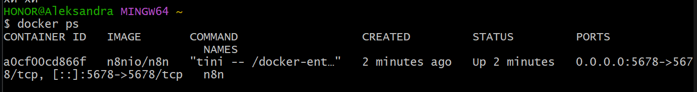
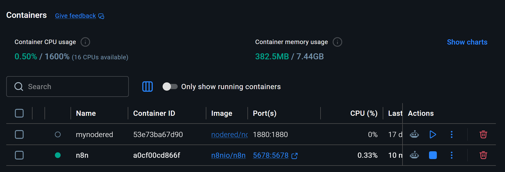
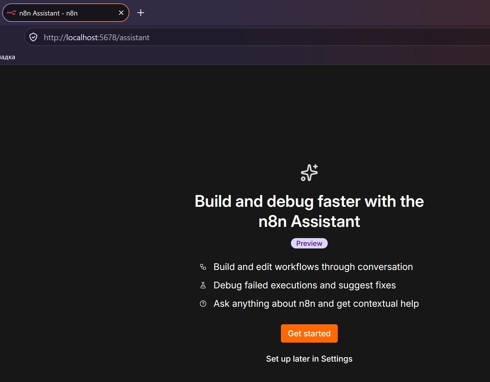

## Часть 2. Workflow

Я собирала каждый пункт в отдельном workflow, названия содержат фамилию (`lab4-Gavrilik-NN-...`), а в payload и topic тоже используется фамилия.

### 2.1. Manual Trigger → Set → Code

В ноде Set (Edit Fields) задала `payload` (строка с фамилией) и `topic = "lab4/Gavrilik/basic"`. В ноде Code получила данные через `$input.all()`, вывела их в консоль и вернула дальше. Workflow выполнен вручную кнопкой Execute workflow.

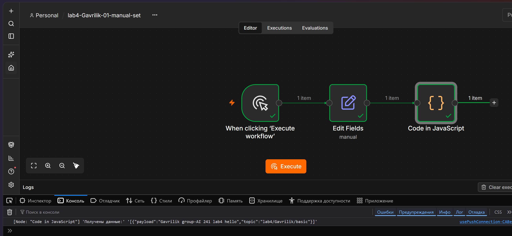

### 2.2. Code node

Workflow Manual Trigger → Code → NoOp. В Code использованы `const`/`let`, массив чисел, цикл `for`, `if/else` и объект. Функция считает сумму элементов массива, количество чётных и вердикт `big`/`small`, а возвращает объект с полем `payload`. Результат для массива `[3, 8, 15, 4, 23]`: сумма 53, чётных 2, вердикт `big`. Нода NoOp ничего не делает и служит конечной точкой.

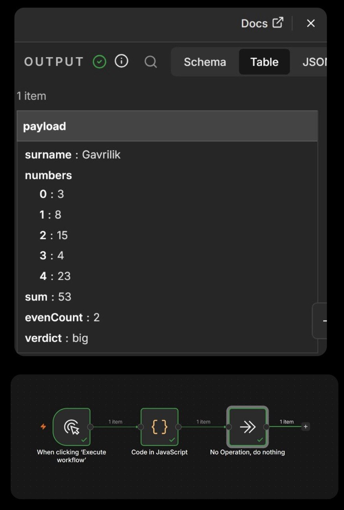

### 2.3. IF node

Workflow Manual Trigger → Code → IF → NoOp (true) / NoOp (false). Логика в Code такая же, как в 2.2, но `payload` возвращается числом (сумма). В IF правило: `{{ $json.payload }}` Number is greater than `50`. Для суммы 53 данные пошли по ветке **true** (в Output видно `payload = 53`, `verdict = big`, `surname = Gavrilik`), а ветка **false** осталась пустой. Если изменить массив на меньшие числа, данные идут по ветке false.

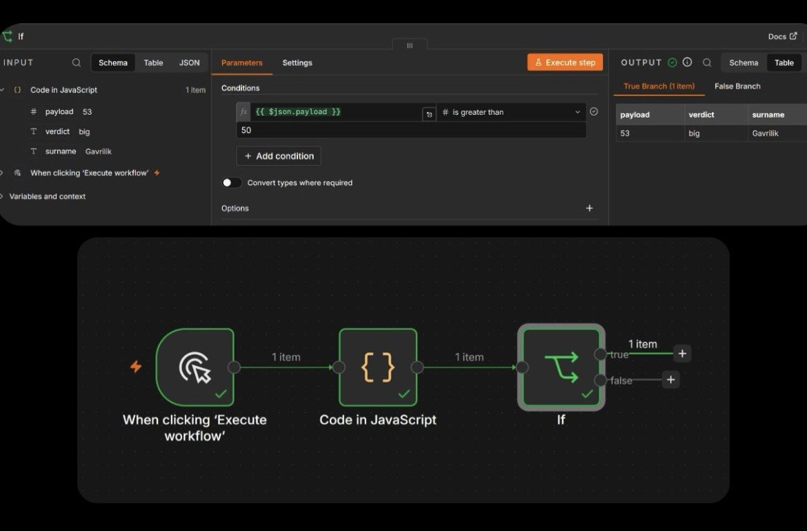


### 2.4. Set node (изменение полей)

В ноде Set задала три поля: `topic = "lab4/Gavrilik/set"`, `timestamp = {{ $now.toISO() }}` (текущее время) и `payload`. В ноде Code вывела полный объект `msg` в консоль и вернула его в Output. При каждом запуске `timestamp` разный.

Во время работы заметила, что триггер оказался отключён (подпись `Deactivated`), из-за этого workflow не запускался. Включила его клавишей `D`.

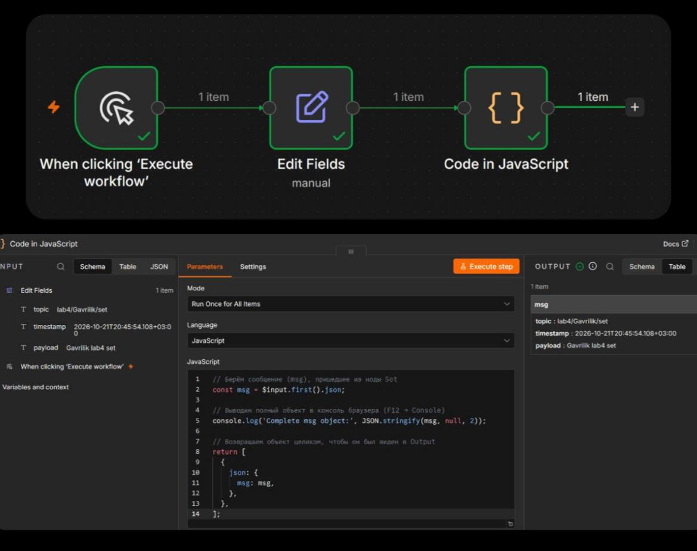

### 2.5. HTTP Request

Workflow Manual Trigger → HTTP Request → Code. Настройки: метод GET, Response Format = JSON. Сначала использовала `https://catfacts.ninja/fact`, но n8n вернул ошибку `The connection cannot be established`: сервер оказался недоступен. Поэтому заменила API на `https://api.chucknorris.io/jokes/random`, который сработал. В Code беру поля ответа (`value`, `id`) и формирую свой объект с `payload`, `topic` и `jokeId`.

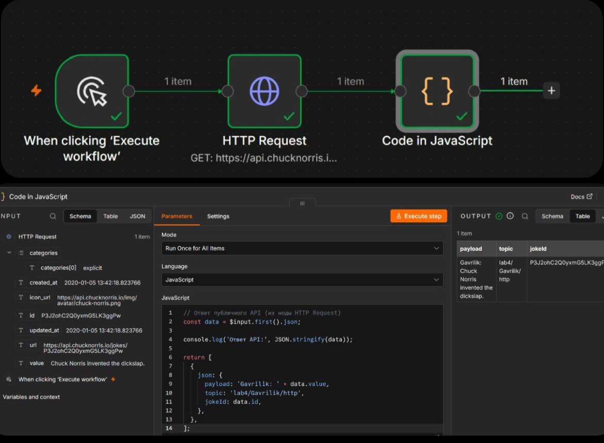
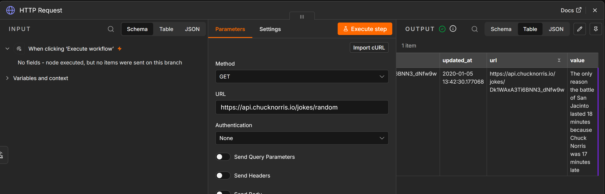

### 2.6. Schedule Trigger

Workflow Schedule Trigger → Code. Расписание: каждую 1 минуту (для демонстрации; допустимо по заданию вместо 5 минут). В Code возвращаю текущее время в формате ISO и в локальном виде (часовой пояс Europe/Minsk). Чтобы расписание работало, workflow нужно опубликовать (Publish). После публикации во вкладке Executions появились успешные запуски раз в минуту. Скриншоты сделаны, после этого workflow снят с публикации (Unpublish), чтобы не срабатывал бесконечно.

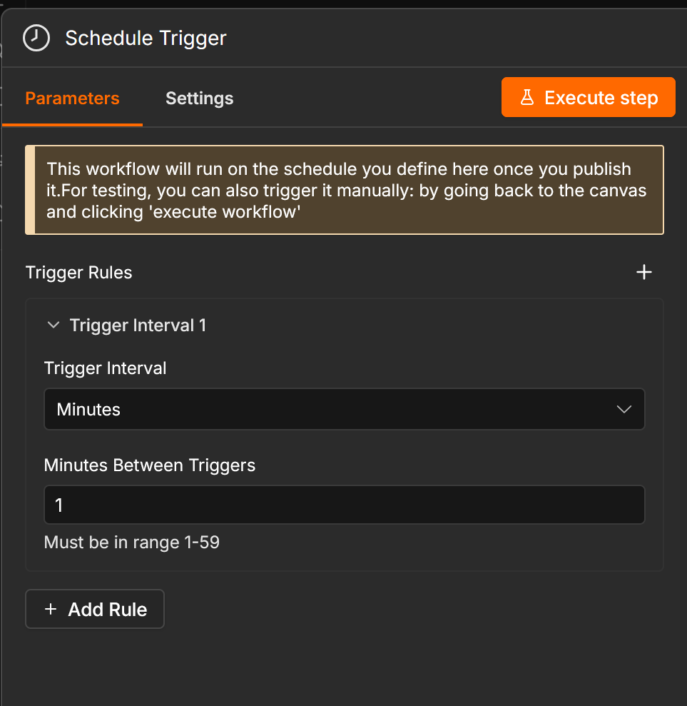
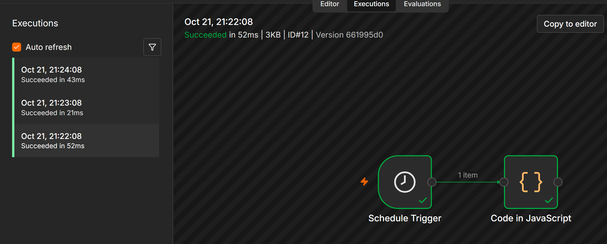


## Часть 3. Redis: создание и удаление ключа

Подробное описание вынесено в [redis.md](redis.md). Кратко:

- Redis запущен командой `docker run -d --name redis -p 6379:6379 redis:7`, проверка `redis-cli ping` вернула `PONG`.
- В n8n создана credential `Redis Gavrilik` (Host `host.docker.internal`, Port `6379`).
- Workflow `flow-09-redis.json`: Manual Trigger → Redis (Set) ключ `gavrilik` → Redis (Get).
- Workflow `flow-10-redis.json`: Manual Trigger → Redis (Delete) → Redis (Get, проверка отсутствия ключа).
- В ноде Redis в n8n нет операции Exists, поэтому отсутствие ключа проверяется через Get (значение пустое) и командой `EXISTS gavrilik` в redis-cli (ответ 0).

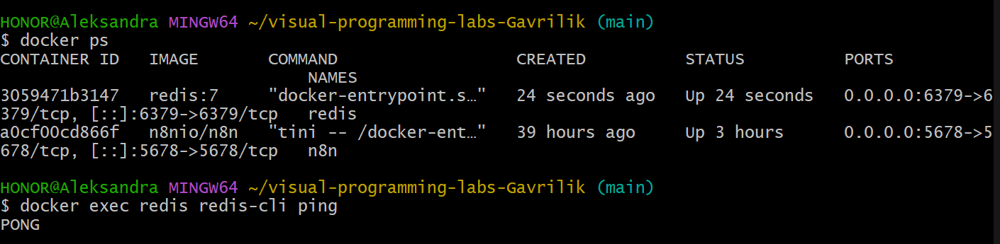

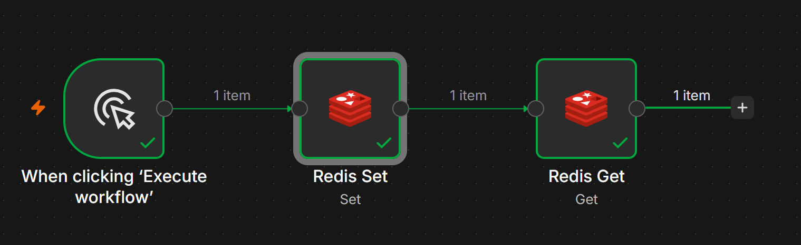
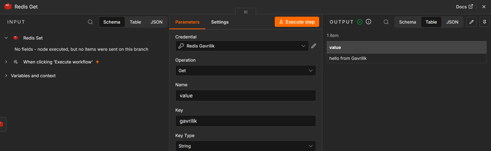
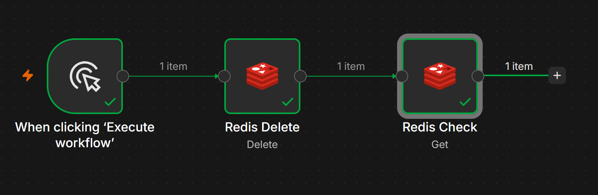
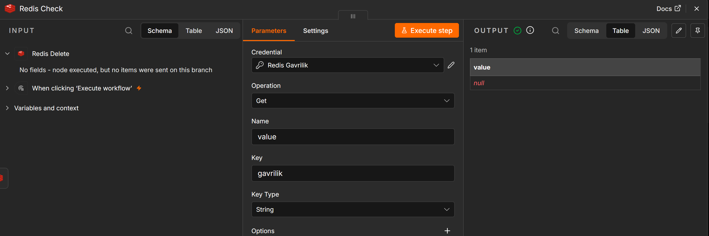

## Ачивка 10. Передача сообщения между двумя workflow через Redis pub/sub

Использован механизм публикации и подписки Redis (pub/sub): один workflow публикует сообщение в канал, другой, независимый, подписан на этот канал и получает сообщение. Канал: `lab4-gavrilik`.

- **Подписчик** (`flow-12-pubsub-subscriber.json`): нода Redis Trigger на канале `lab4-gavrilik` (включены опции JSON Parse Body и Only Message), затем нода Code, которая выводит полученное сообщение в поле `received`. Workflow опубликован (Publish), поэтому постоянно слушает канал.
- **Издатель** (`flow-11-pubsub-publisher.json`): Manual Trigger → Redis (Publish) в канал `lab4-gavrilik`. Сообщение формируется выражением `JSON.stringify({ from: 'Gavrilik', text: 'hello via redis pub/sub', time: $now.toISO() })`.
- После запуска издателя в подписчике появилась новая успешная запись во вкладке Executions, а в ноде Code в поле `received` лежало отправленное сообщение с фамилией.

Проверка подписки на стороне Redis: команда `docker exec redis redis-cli PUBSUB NUMPAT` показывает число подписок. Команда `PUBSUB CHANNELS` в моём случае вернула пустой список, так как Redis Trigger в n8n подписывается по шаблону, а `PUBSUB CHANNELS` такие подписки не показывает.

Важная особенность pub/sub: сообщение нигде не хранится. Его получают только те, кто в момент публикации подписан на канал. Если издатель запустится раньше, чем подписчик начал слушать, сообщение будет потеряно (в отличие от Set/Get, где значение остаётся в Redis).

После проверки подписчик снят с публикации (Unpublish).

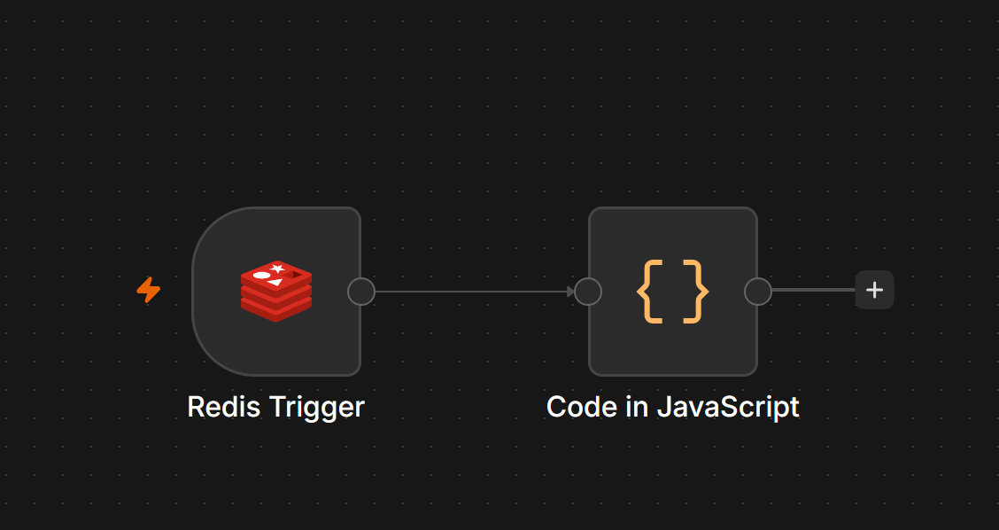
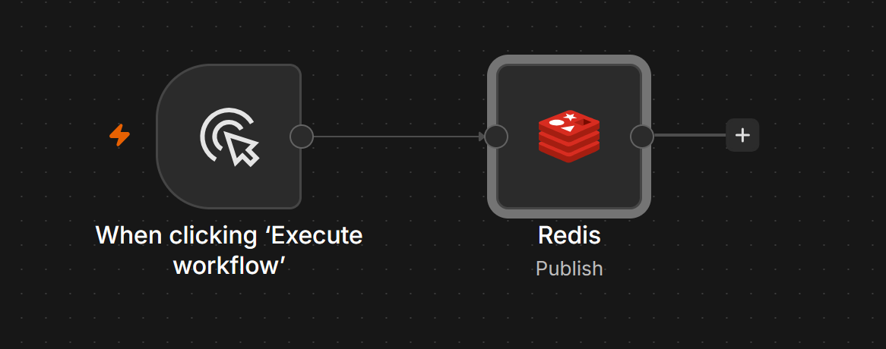
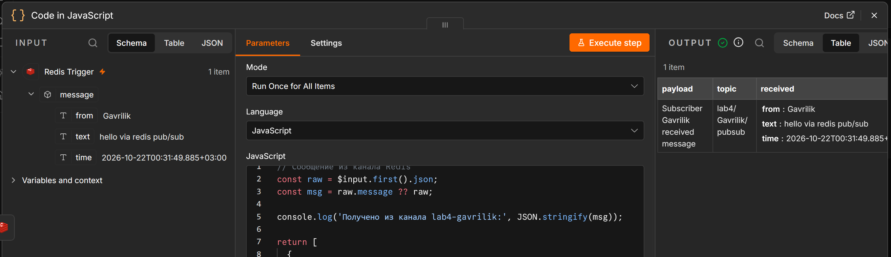

## Использованные AI-промпты

Использовала Claude как помощника для пошагового выполнения. Ключевые примеры запросов:

1. «Делаем лабораторную работу 4. Начинаем делать всё пошагово, подробно описывая, что делаем, начиная с GitHub. Выбери наиболее лёгкую ачивку, кроме 5.1, 1.1, 1.2, 9, 2, 4» результат: структура репозитория `lab4`, выбор ачивки 10 (Redis pub/sub) и план работы.
2. Запрос по ошибке в HTTP Request («The connection cannot be established») со скриншотом результат: диагностика и замена публичного API на `api.chucknorris.io`.
3. «Как отключить Docker и всё остальное» результат: порядок остановки контейнеров (`docker stop`), возврата к работе (`docker start`) и сохранения данных в volume.
4. Запросы на описание Redis-workflow и проверку отсутствия ключа результат: выяснили, что в n8n нет операции Exists, и заменили её на Get плюс `EXISTS` в redis-cli.
5. Запрос «пусто» после `PUBSUB CHANNELS` в ачивке 10 результат: поняла, что подписка Redis Trigger видна через `PUBSUB NUMPAT`, а подписчик при этом работает.

Результат каждого шага я проверяла сама: запускала workflow, смотрела Output нод и состояние контейнеров.

## Освоенные ноды

| Нода | Назначение |
|---|---|
| Manual Trigger | ручной запуск workflow кнопкой Execute workflow |
| Schedule Trigger | запуск по расписанию (работает у опубликованного workflow) |
| Set (Edit Fields) | создание и изменение полей элемента, в том числе через выражения |
| Code | произвольная логика на JavaScript |
| IF | ветвление по условию на ветки true и false |
| NoOp | заглушка без действий, конечная точка ветки |
| HTTP Request | запрос к внешнему API (GET, ответ в JSON) |
| Redis (Set, Get, Delete, Publish) | работа с ключами Redis и публикация сообщений |
| Redis Trigger | подписка на канал Redis и запуск workflow по сообщению |

## Выводы

n8n оказался удобным инструментом: workflow собираются из готовых нод, а где нужна своя логика, помогает нода Code. Данные между нодами передаются как элементы с полем `json`, и к ним обращаются через выражения вида `{{ $json.payload }}`. Установка через Docker с двумя volume позволяет не терять данные при остановке и пересоздании контейнера, а credentials хранятся отдельно от workflow, поэтому в экспортированных JSON нет паролей.

Самым полезным было разбираться с ошибками: триггер, случайно отключённый клавишей `D`, недоступный публичный API и пустой результат `PUBSUB CHANNELS` научили читать сообщения n8n и проверять, где именно проблема: в workflow, в сети или в способе проверки. С Redis понравилась простота модели «ключ → значение» и то, что один и тот же Redis можно использовать и для хранения данных, и для обмена сообщениями между независимыми workflow (pub/sub). Кроме того, я поняла разницу между `localhost` внутри контейнера и на хосте, поэтому в credentials указан `host.docker.internal`.