# Лабораторная работа №5. Чат-боты

**Студент:** Гаврилик, группа AI-241
**Выбранный трек:** C. TypeBot (TypeBot Cloud)
**Ссылка на бота:** https://typebot.co/lab5-gavrilik-ai-241-bot-vlkc6te
**Экспорт flow:** [`../exports/flow-01-lab5-gavrilik-ai-241.json`](../exports/flow-01-lab5-gavrilik-ai-241.json)

## 1. Описание выбранного трека

Я выбрал трек C (TypeBot), потому что он работает целиком в браузере: не нужно подключать мессенджеры (как в ManyChat) и приглашать одногруппников (как в Botpress). TypeBot — визуальный конструктор чат-ботов, в котором диалог собирается из блоков, соединённых линиями.

За основу взят готовый шаблон из галереи Templates: бот агентства «AA (Awesome Agency)», который собирает заявку: приветствие, имя, email, интересующая услуга, дополнительные пожелания, прощание.

Что сделано с шаблоном:

1. Полностью русифицирован: тексты сообщений, кнопки, подсказки в полях ввода, подписи кнопок отправки, сообщение об ошибке email, названия групп.
2. Добавлена переменная `Services`, в которую сохраняется выбор услуги.
3. Добавлена группа с блоком **Condition**: если выбрана услуга «Разработка сайтов», бот передаёт заявку веб-менеджеру, иначе общему менеджеру.
4. Добавлена переменная `Manager` и два блока **Set variable**, которые записывают в неё имя менеджера.
5. Добавлены новые текстовые блоки для каждой ветки и сообщение «Ваш менеджер: ...» в конце диалога.
6. Добавлен блок **HTTP Request**, который отправляет данные заявки POST-запросом на тестовый адрес webhook.site.
7. Изменена тема оформления: фон, шрифт, цвета сообщений и кнопок.
8. Бот опубликован по веб-ссылке, flow экспортирован в JSON.

## 2. Структура бота

| Группа | Что происходит |
|---|---|
| Приветствие | Текст приветствия, картинка, кнопка «Привет!» |
| Имя | Вопрос «Как вас зовут?», ответ сохраняется в переменную `Name` |
| Email | Приветствие с подстановкой `{{Name}}`, ввод email с проверкой формата, ответ в переменную `Email` |
| Услуги | Четыре кнопки с услугами, ответ сохраняется в переменную `Services` |
| Дополнительная информация | Вопрос о потребностях, свободный текст |
| Распределение заявки | Блок Condition: `Services` = «Разработка сайтов» → ветка 1, иначе ветка 2 (Else) |
| Веб-менеджер | Set variable: `Manager` = «Анна (отдел веб-разработки)» + текстовое сообщение |
| Общий менеджер | Set variable: `Manager` = «Мария (отдел услуг)» + текстовое сообщение |
| Прощание | Сообщения, «Ваш менеджер: `{{Manager}}`», блок HTTP Request |

### Переменные

- `Name` — имя пользователя (блок ввода текста);
- `Email` — email пользователя (блок ввода email, есть проверка формата);
- `Services` — выбранная услуга (блок Buttons);
- `Manager` — назначенный менеджер (блоки Set variable).

### Условие

Блок Condition проверяет: `Services` равно «Разработка сайтов». Если условие выполнено, бот идёт по первой ветке, иначе по ветке Else. Значения кнопок были переведены на русский до создания условия, поэтому текст в условии совпадает с текстом кнопки.

### Интеграция (HTTP Request)

В конце диалога бот отправляет POST-запрос на тестовый адрес сервиса webhook.site с заголовком `Content-Type: application/json` и телом:

```json
{
  "student": "Gavrilik AI-241",
  "name": "{{Name}}",
  "email": "{{Email}}",
  "service": "{{Services}}",
  "manager": "{{Manager}}"
}
```

Typebot подставляет вместо `{{...}}` реальные значения переменных. На webhook.site видно, что запрос дошёл и данные подставились.

## 3. Использованные AI-промпты

Работа выполнялась по шагам с помощью Claude. Ключевые запросы:

1. **Постановка задачи.** Загрузил файл с заданием и написал: «выбирай наиболее лёгкий и понятный вариант, делаем пошагово и подробно с каждым шагом, начинаем с гитхаба подробно». Результат: выбор трека C и пошаговый план, начиная с создания папки `lab5` и шаблона отчёта в репозитории.
2. **Русификация шаблона.** Отправил скриншот flow выбранного шаблона и попросил помочь с переводом. Результат: таблица «было / стало» по каждой группе, включая подписи кнопок и сообщение об ошибке, с напоминанием не трогать переменные.
3. **Сохранение выбора в переменную.** Отправил скриншот блока с кнопками и спросил, где найти поле «Save answer in a variable». Результат: объяснение, что нужно кликнуть на блок целиком, а не на группу, и создать переменную `Services`.
4. **Условие.** Отправил скриншот собранного блока Condition (`IF Services = Разработка сайтов`, `Else`) для проверки. Результат: подтверждение и инструкция, как построить две ветки с переменной `Manager`.
5. **Проверка всей цепочки.** Попросил: «напиши всю цепочку вместе с ботом». Результат: таблица полного диалога с ботом и ожидаемый JSON, который должен прийти на webhook.site.

## 4. Освоенные блоки и элементы

- **Bubbles (сообщения бота):** Text, Image.
- **Inputs (ввод пользователя):** Text, Email, Buttons.
- **Logic:** Condition (ветвление), Set variable (запись значения в переменную).
- **Integrations:** HTTP Request (POST-запрос с JSON-телом и заголовком).
- **Переменные:** создание, сохранение ответа пользователя в переменную, подстановка `{{Имя}}` в текст и в тело запроса.
- **Группы и линии:** соединение групп, несколько входящих линий в одну группу.
- **Theme:** настройка фона, шрифта, цветов сообщений и кнопок.
- **Test:** отладка бота в окне предпросмотра.
- **Publish и экспорт:** публикация по веб-ссылке, экспорт flow в JSON.

## 5. Скриншоты и ход работы

### 5.1. Регистрация и workspace


*Рис. 1. Вход в TypeBot Cloud.*


*Рис. 2. Workspace с названием lab5-Gavrilik-AI-241.*

### 5.2. Шаблон до и после русификации

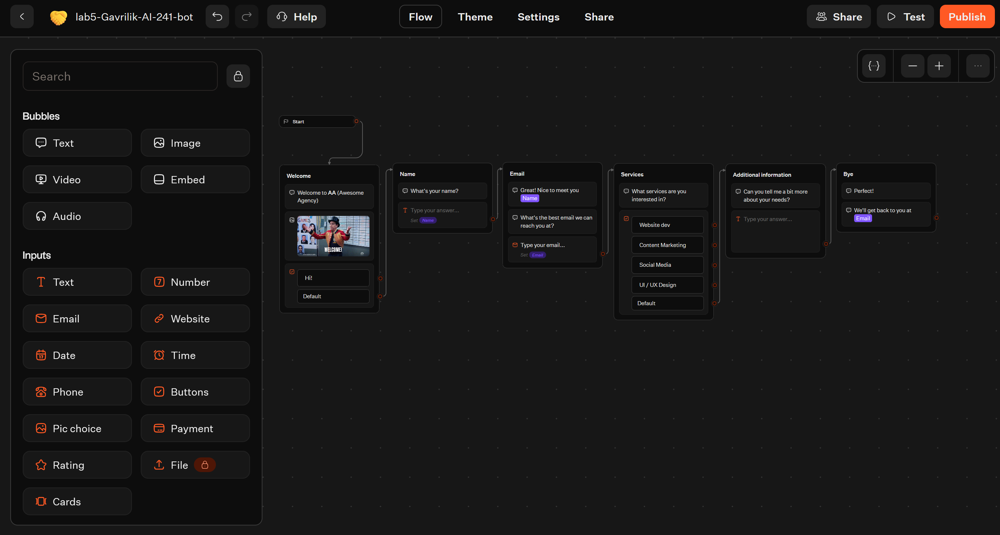

*Рис. 3. Исходный шаблон на английском.*

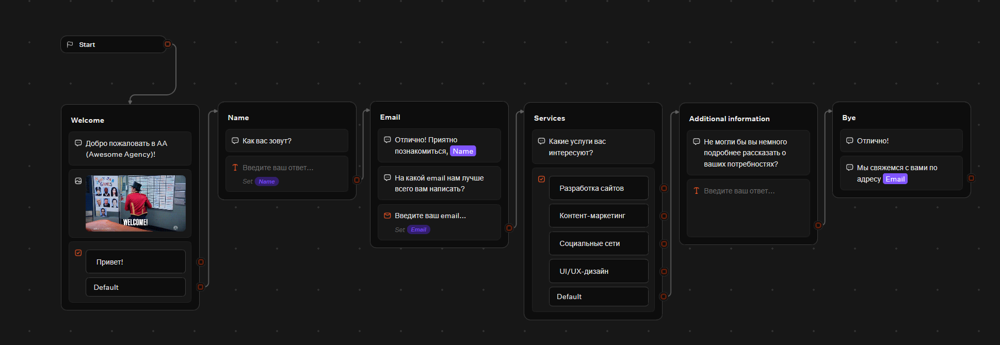

*Рис. 4. Тот же шаблон после русификации.*

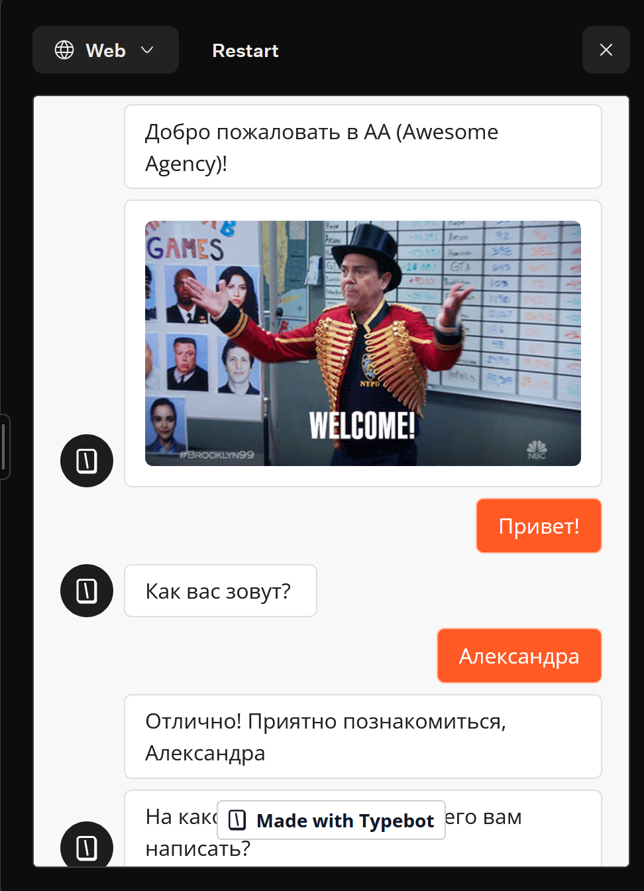

*Рис. 5. Проверка перевода в окне теста: переменная `Name` подставилась в сообщение.*

### 5.3. Переменная, условие и блоки Set variable

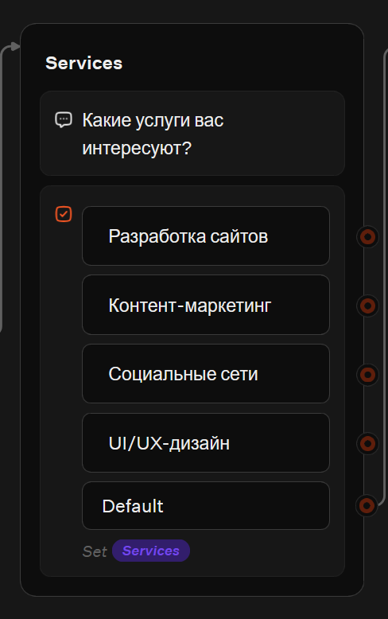

*Рис. 6. Блок кнопок сохраняет ответ в переменную `Services`.*


*Рис. 7. Блок Condition: `Services` = «Разработка сайтов», вторая ветка Else.*

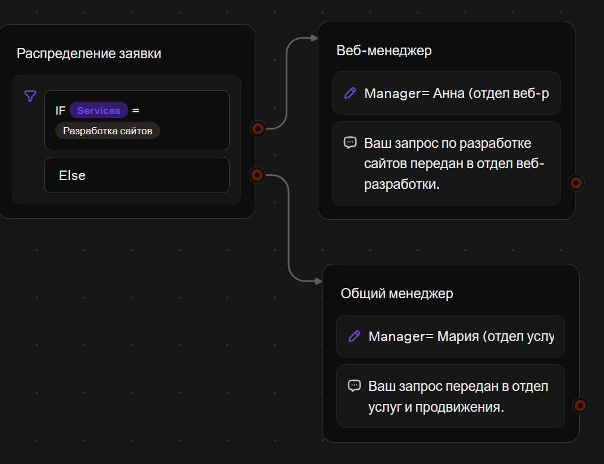

*Рис. 8. Блок Set variable, записывающий значение в переменную `Manager`.*

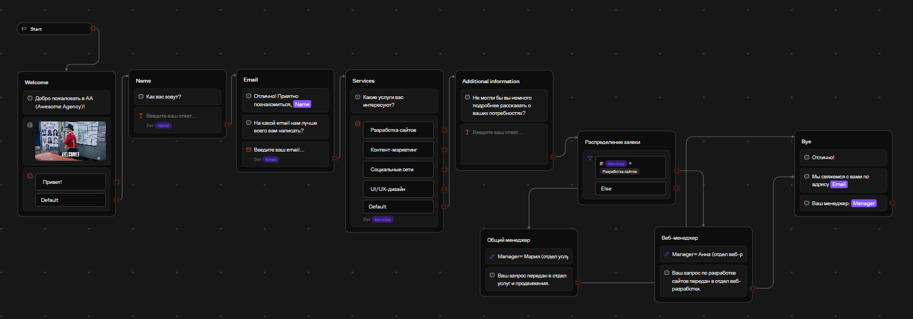

*Рис. 9. Весь flow после добавления логики.*

### 5.4. Проверка обеих веток

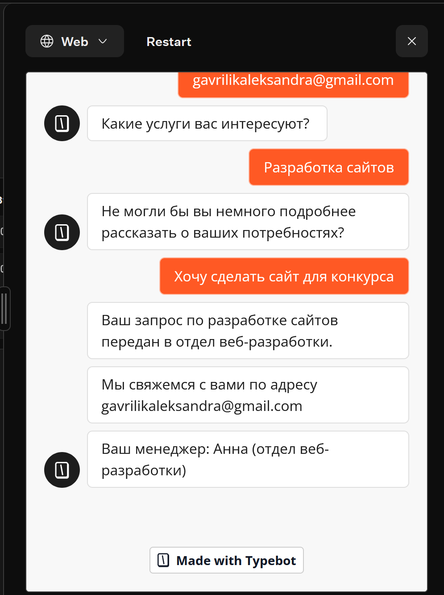

*Рис. 10. Ветка «Разработка сайтов»: менеджер Анна.*

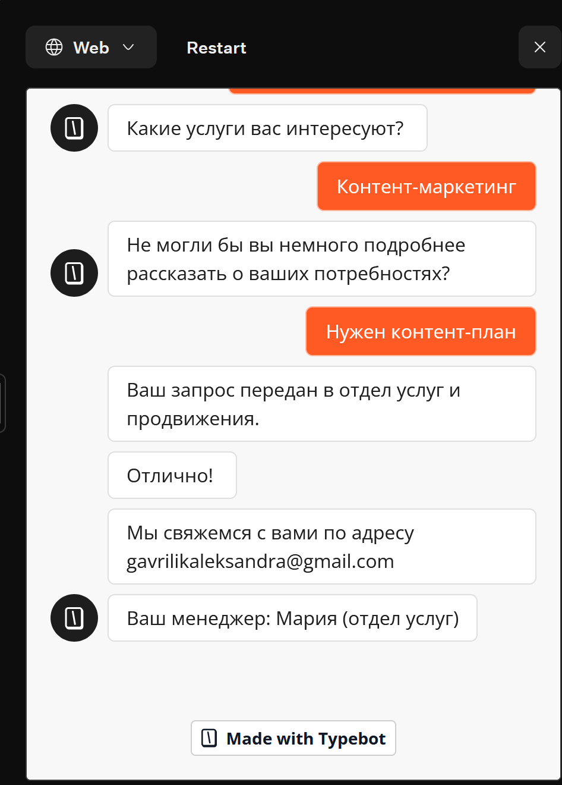

*Рис. 11. Остальные услуги: менеджер Мария.*

### 5.5. HTTP Request

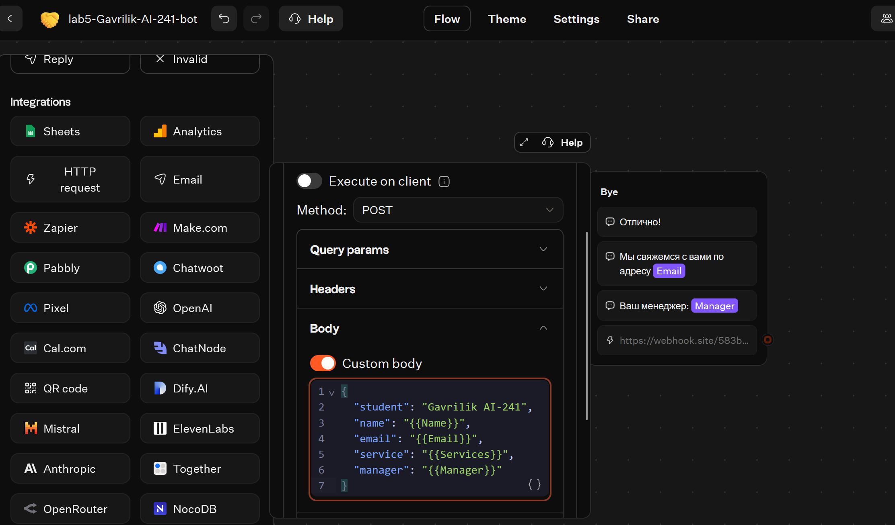

*Рис. 12. Настройки блока HTTP Request: метод POST, адрес, заголовок и тело запроса.*

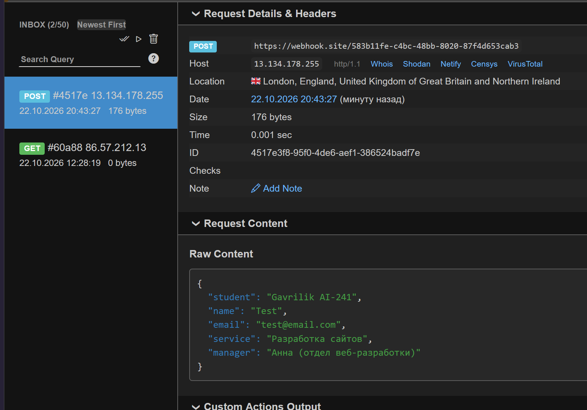

*Рис. 13. На webhook.site пришёл запрос с данными заявки.*

### 5.6. Тема и брендинг

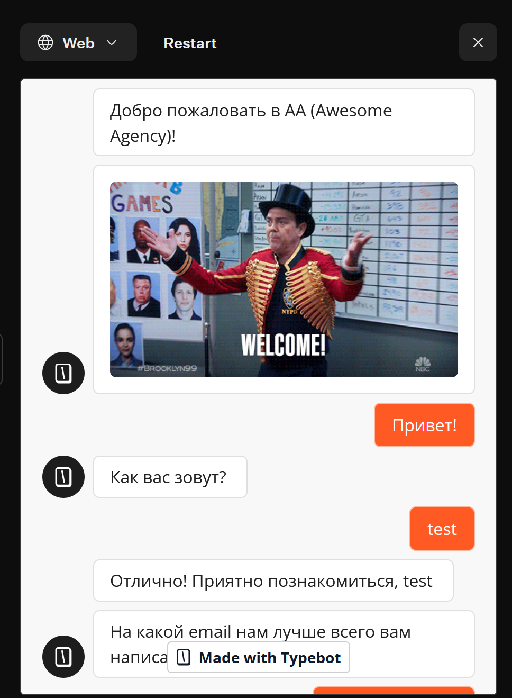

*Рис. 14. Стандартная тема.*

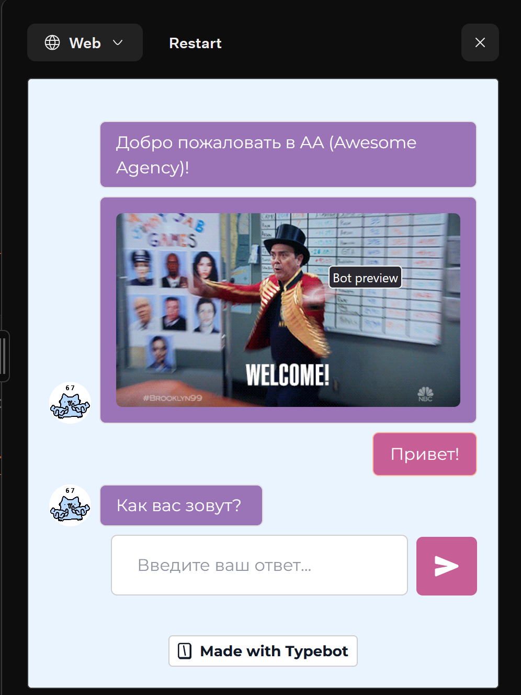

*Рис. 15. Изменённая тема: другие фон, шрифт и цвета.*

### 5.7. Публикация

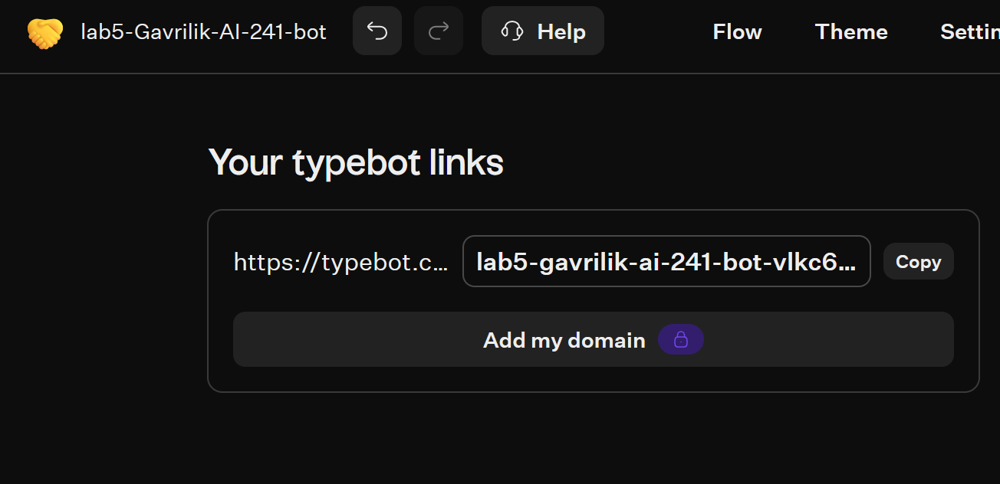

*Рис. 16. Ссылка на опубликованного бота на вкладке Share.*

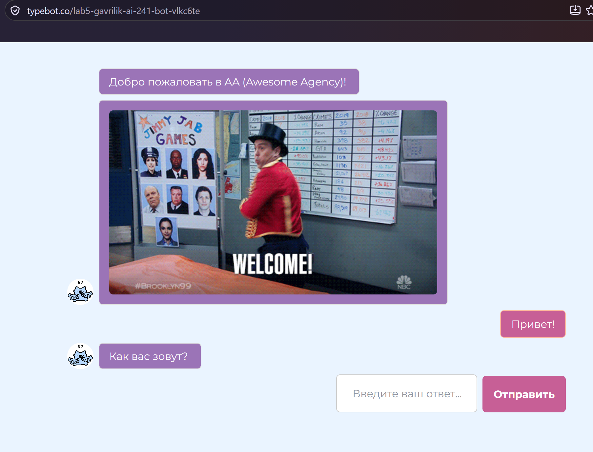

*Рис. 17. Бот, открытый по публичной ссылке в браузере.*

## 6. Ограничения бесплатного тарифа

- Внизу чата отображается плашка «Made with Typebot», убрать её на бесплатном тарифе нельзя.
- Часть блоков закрыта на бесплатном тарифе (например, блок File помечен замком).
- Число чатов в месяц ограничено, поэтому бот подходит для учебных и небольших задач.

## 7. Выводы

В этой работе я собрал бота-помощника для приёма заявок в визуальном конструкторе TypeBot и увидел, что диалог можно построить без программирования: достаточно соединить блоки линиями. Самым полезным оказалось связать между собой переменные, условие и интеграцию: ответ пользователя сохраняется в переменную, по нему условие выбирает ветку, а в конце все данные уходят во внешний сервис. Русификация показала, что при переводе нельзя ломать названия переменных и значения кнопок, иначе условие перестанет срабатывать. Тестовый режим помог быстро найти ошибки в линиях и переменных. Блок HTTP Request показал, как чат-бот взаимодействует с внешними системами, например с CRM или таблицей заявок. Из ограничений бесплатного тарифа я заметил обязательную плашку Typebot и закрытые платные блоки.