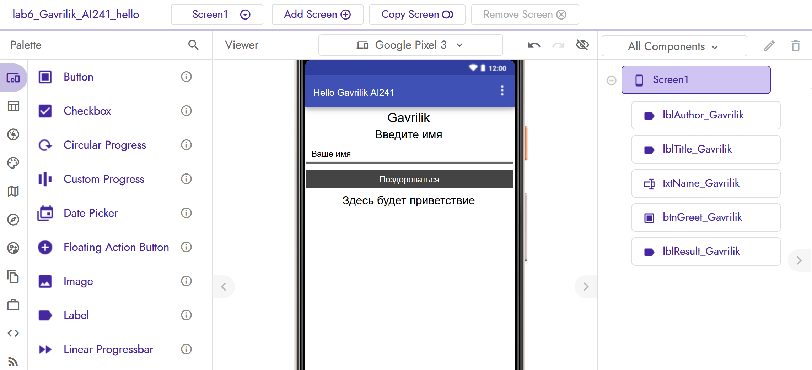
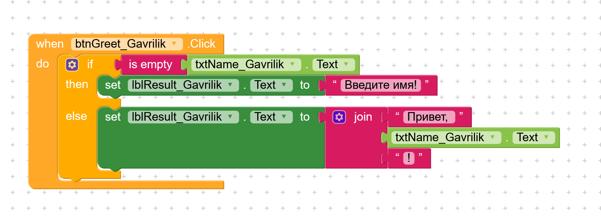
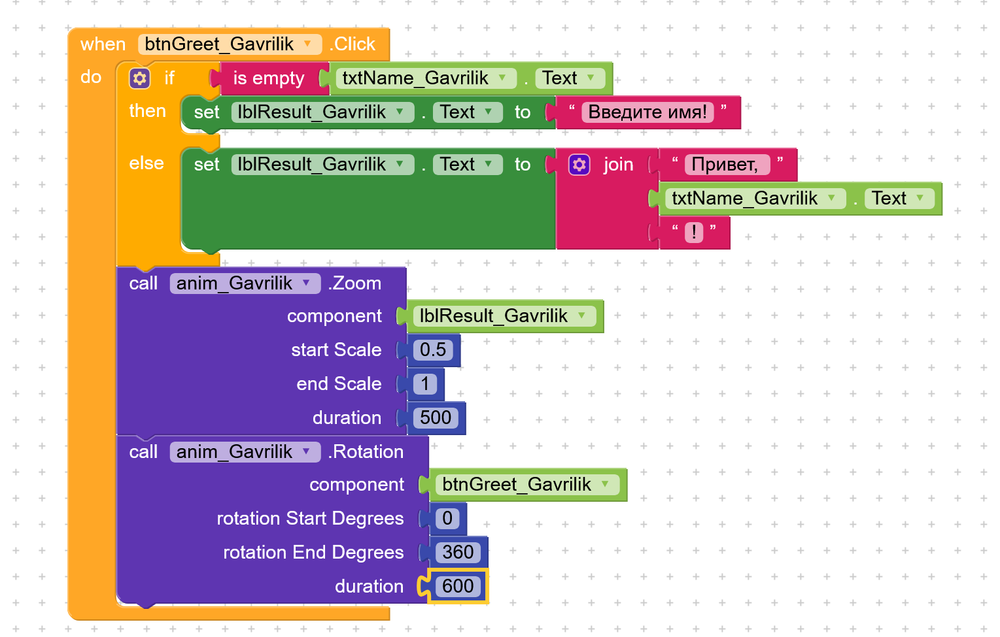
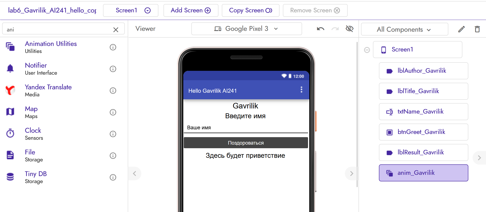

# Лабораторная работа №6. Kodular

## 1. Описание приложения

В low-code платформе Kodular создано мобильное приложение «Приветствие» (проект `lab6_Gavrilik_AI241_hello`). Пользователь вводит имя в текстовое поле и нажимает кнопку «Поздороваться». Если поле пустое, приложение выводит «Введите имя!», иначе выводит «Привет, <имя>!». На экране вверху всегда отображается моя фамилия на английском языке: Gavrilik.

Реализованные дополнительные возможности:
- **Ачивка 11: Анимация** (по нажатию на кнопку результат плавно увеличивается, а кнопка делает полный оборот).

## 2. Ссылка на проект

Проект в Kodular Gallery не публиковался. Файл проекта в формате .aia: `lab6/exports/lab6-Gavrilik.aia`.

## 3. Базовая часть

### 3.1. Дизайн Screen1

На экране Screen1 расположены (сверху вниз):

| Компонент | Имя | Основные свойства |
|---|---|---|
| Label | `lblAuthor_Gavrilik` | Text = `Gavrilik`, выравнивание по центру, размер шрифта 20 |
| Label | `lblTitle_Gavrilik` | Text = `Введите имя` |
| Text Box | `txtName_Gavrilik` | Hint = `Ваше имя` |
| Button | `btnGreet_Gavrilik` | Text = `Поздороваться` |
| Label | `lblResult_Gavrilik` | Text = `Здесь будет приветствие` |

Для всех компонентов ширина задана как Fill parent. В именах компонентов и проекта использована моя фамилия, чтобы работа была уникальной.

### 3.2. Блоки (логика)

Логика построена на одном обработчике события `when btnGreet_Gavrilik.Click`:

1. Блок `if` проверяет условие `is empty(txtName_Gavrilik.Text)`, то есть пусто ли поле ввода.
2. Ветка `then` (поле пустое): `set lblResult_Gavrilik.Text to "Введите имя!"`.
3. Ветка `else` (имя введено): `set lblResult_Gavrilik.Text to join("Привет, ", txtName_Gavrilik.Text, "!")`.

Блок `join` склеивает три части: текст «Привет, », введённое имя и восклицательный знак. Условный блок `if/else` выбирает, какое из двух сообщений показать.

## 4. Ачивки

### Ачивка 11: Анимация

Для анимации в проект добавлен невидимый компонент **Animation Utilities** (`anim_Gavrilik`, категория Utilities). В обработчик нажатия на кнопку после блока `if/else` добавлены два вызова методов компонента:

- `call anim_Gavrilik.Zoom` для `lblResult_Gavrilik`: масштаб меняется от 0.5 до 1 за 500 мс, поэтому текст приветствия плавно увеличивается;
- `call anim_Gavrilik.Rotation` для `btnGreet_Gavrilik`: поворот от 0° до 360° за 600 мс, кнопка делает полный оборот.

Использованные компоненты: Animation Utilities. Использованные блоки: вызовы методов Zoom и Rotation, блок-компонент (передаётся в параметр component), числовые блоки Math.

## 5. AI-промпты

Использование ИИ было частью работы, ниже ключевые обращения:

1. «Делаем 6 лабу пошагово и со всеми подробностями» (получены структура папки `lab6`, шаблон отчёта и план коммитов).
2. Скриншот окна «Configure your project» с вопросом, что вписать в App Name и Package Name (настройка нового проекта).
3. Скриншот редактора с просьбой рассказать подробно, что делать, как изображено на скриншоте (пошаговая сборка дизайна Screen1).

## 6. Освоенные компоненты и блоки

**Компоненты:**
- Label (текст, выравнивание, размер шрифта);
- Text Box (свойство Hint);
- Button;
- Animation Utilities (невидимый компонент для анимации).

**Блоки:**
- событие `when ... Click`;
- условный блок `if / then / else`;
- проверка строки `is empty`;
- соединение строк `join`;
- текстовые константы и числовые блоки;
- геттер и сеттер свойства `Text`;
- вызов методов `Zoom` и `Rotation`.

**Навыки:** создание и настройка проекта в Kodular, переименование компонентов, настройка свойств в Designer, сборка логики из блоков, экспорт проекта в .aia, работа с Git (папка, коммиты, push).

## 8. Выводы

В ходе работы я познакомился с платформой Kodular и создал простое мобильное приложение без написания кода. Основной принцип визуального программирования здесь в том, что дизайн экрана собирается из готовых компонентов в Designer, а логика из блоков, которые сцепляются друг с другом как пазлы. Блоки `if/else` и `join` дали понять, как работают условия и работа со строками. Самым неочевидным оказалось правильное сцепление блоков: блок может лежать рядом с нужным местом и выглядеть вставленным, но не быть частью цепочки. Об этом сигнализировал красный значок ошибки, а проверить можно, потянув за родительский блок.

Ачивка с анимацией показала, что в Kodular визуальные эффекты подключаются отдельным невидимым компонентом, методы которого вызываются из блоков. Платформа удобна быстрым стартом и тем, что результат можно проверить сразу, но интерфейс и названия пунктов меню отличаются от того, что описано в учебных материалах, поэтому приходилось ориентироваться по скриншотам. Из ограничений можно отметить, что бесплатный тариф ограничивает число проектов, ассеты и расширения, хотя для учебного приложения этого достаточно.